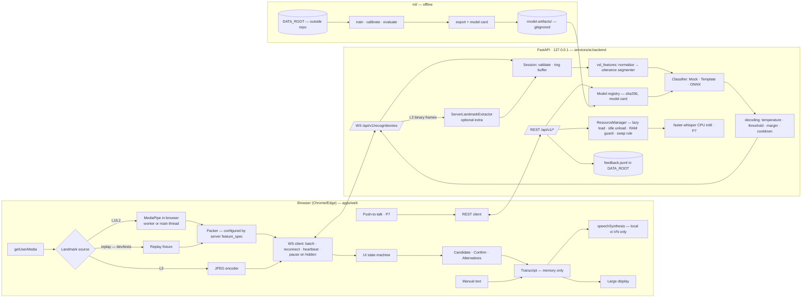
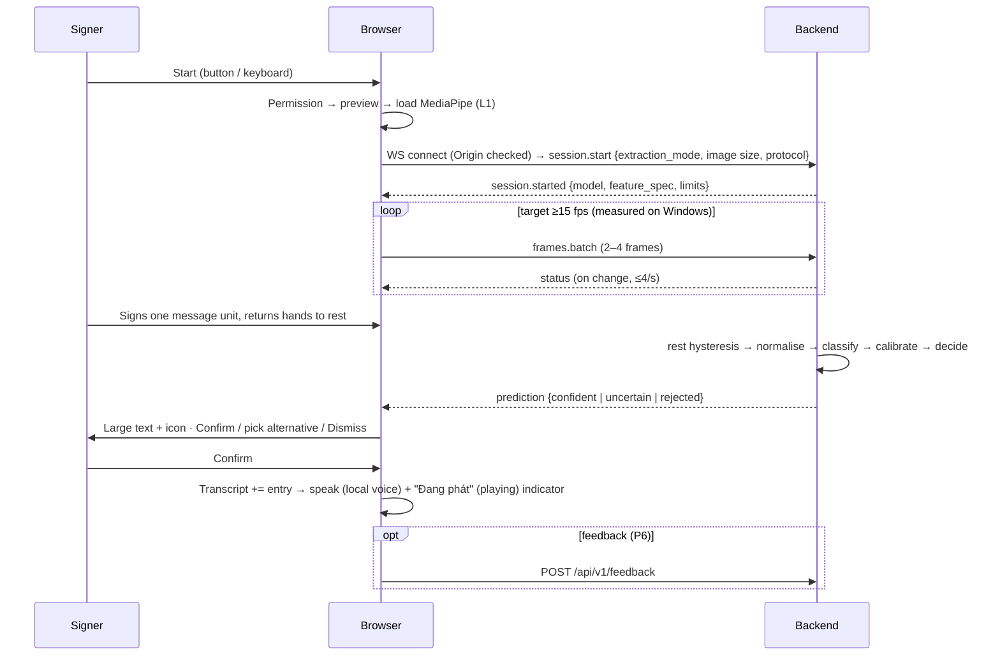

# Architecture

Architecture decisions are recorded in [DECISIONS.md](DECISIONS.md), and contracts in [API_CONTRACTS.md](API_CONTRACTS.md).

## 1. Overview

The app is a **modular monolith** made of two local processes, plus offline ML tooling:

| Process | Technology | Responsibility |
|---|---|---|
| Browser app (`apps/web`) | React + TypeScript + Vite, Chrome/Edge | Camera, MediaPipe landmark extraction (L1/L2), landmark packing, UI state machine, transcript, confirmation, local TTS, push-to-talk capture (P7) |
| Backend (`services/ai-backend`) | Python 3.12, FastAPI, Pydantic v2 | WebSocket recognition sessions, validation, buffering, segmentation, classification, decoding; REST for health, vocabulary, models, feedback, and STT (P7); optional server-side extraction (L3) |
| Offline ML (`ml/`) | PyTorch (CPU), scikit-learn | Training, calibration, evaluation, export to `model-artifacts/`. Never in the request path. |
| Shared library (`packages/vsl-features`) | NumPy only | Feature spec, normalisation, segmentation, decoding. Used by **both** the backend and `ml/` so that training and serving preprocess data identically. |

All processes bind to `127.0.0.1`. There is no database, no authentication, no Docker, and no cloud. ADR-001, ADR-006, and ADR-012 explain why.

## 2. Primary flow: sign → text → speech

## 3. Reverse flow: speech → subtitles (P7, gated at G7)

1. The teacher **holds** the push-to-talk control. There is no always-on voice detection.
2. The browser captures 16 kHz mono PCM through an AudioWorklet and builds a WAV of at most 30 s.
3. The browser sends `POST /api/v1/stt/transcriptions`. The ResourceManager loads faster-whisper on CPU at int8 precision when it is first needed.
4. Transcription runs in a threadpool, with at most 1 concurrent job.
5. The response `{text, segments}` is shown in the subtitle panel and added to the transcript with `source: speech`.
6. The audio buffer is dropped right away. It is never written to disk.

## 4. Component responsibilities

| Component | Location | Responsibility | Phase |
|---|---|---|---|
| Camera hooks | `apps/web/src/features/camera` | Permission, device list, stream lifecycle | P2 |
| Landmark sources | `features/landmarks` | `CameraLandmarkSource` (MediaPipe), `ReplayLandmarkSource` (fixtures), `ServerExtractionSource` (L3 JPEG frames) | P3 |
| Packer | `features/landmarks/landmarkPacker.ts` | Shapes and face-index selection, taken from the server's `feature_spec` | P3 |
| WS client | `api/ws.ts` | Batching, heartbeat, reconnect with backoff, close-code handling | P3 |
| Recognition machine | `features/recognition/recognitionMachine.ts` | Explicit reducer: states, candidate policy, pause | P3 |
| Transcript | `features/transcript` | In-memory list, export on user action | P2 |
| TTS | `features/tts` | Selects local `vi-VN` voices, playback state | P2 |
| App factory | `vsl_backend/main.py` | Lifespan, routers, error handlers, security middleware | P1 |
| Config | `vsl_backend/config.py` | Typed settings from env/`.env`, mock-mode guard | P1 |
| Security | `vsl_backend/security.py` | Origin allow-list (HTTP and WS), size limits, CSP header | P1 |
| Classifiers | `vsl_backend/recognition/classifiers.py` | `Classifier` protocol; `MockClassifier` (P1), `TemplateClassifier` (P3), `OnnxClassifier` (P5) | P1–P5 |
| Session / pipeline | `vsl_backend/recognition/` | Per-connection state, buffer, orchestration | P3 |
| Server extractor | `vsl_backend/extraction/server_extractor.py` | L3: Python MediaPipe, decoding JPEG to the same `feature_spec` | P3 spike |
| Model registry | `vsl_backend/inference/model_registry.py` | Resolves `VSL_SIGN_MODEL_ID`, checks sha256 and the model card | P3/P5 |
| Resource manager | `vsl_backend/inference/resource_manager.py` | Heavy-model slot, lazy load, idle unload, RAM and VRAM guards | P6–P7 |
| Feature library | `packages/vsl-features` | Spec, normalisation, segmenter, decoding | P3 |

## 5. Landmark extraction ladder (ADR-002)

| Level | Where | Configuration | When |
|---|---|---|---|
| **L1** | Browser | MediaPipe Holistic, GPU delegate, Web Worker if the P3 spike passes | Default |
| **L2** | Browser | 480p input, Hand + Pose landmarkers, no face | L1 p50 < 15 fps for 5 s after a 3 s warm-up |
| **L3** | Backend (same laptop) | Browser sends JPEG frames (≤640×480, ≤20 fps, ≤200 KB each) as binary WS messages; Python MediaPipe (`[server-extraction]` extra) | L2 is still < 15 fps. The UI **offers** L3, and the user must confirm. |

**Implementation (P3):**
- `features/metrics/ladder.ts` holds the pure decision logic (unit-tested). `useRecognitionSession` feeds it fps once per second.
- When L1 is too slow, `extractionLevel` in settings becomes L2 for the next session. When L2 is too slow, the panel shows a button; pressing it stops the session and starts a new one at L3, which counts as a session boundary.
- L1/L2 run through `features/landmarks/extractor.ts`, which tries a module Web Worker (`landmark.worker.ts`, ES-module WASM loader) and falls back to the main thread. The mode in use is shown in Settings → Hiệu năng (performance).
- None of this has executed yet (no MediaPipe on the Mac); the Windows procedure is in CROSS_PLATFORM_SETUP §11.

Rules for moving between levels:
- Switches happen **only at session boundaries**, never in the middle of an utterance.
- The chosen level is remembered per machine in `localStorage`.
- If L3 is also below 15 fps, recognition is disabled on that machine and manual text remains available.

Caveats about the ladder:
- A low frame rate reduces how often movement is *sampled*. It does not cause motion blur, which depends on camera exposure and lighting.
- L3 shares the same CPU as the browser, so it is not guaranteed to be faster. All three levels are measured on Windows in P3.
- The JS and Python extractors may give slightly different landmarks. A parity test is required, and `extractor_backend` is recorded in the manifest and model card.

## 6. State management

- **Browser UI state** is split in two. Camera state lives in `useCamera` (`idle`, `requesting`, `active`, `failed: denied|unavailable|in_use|insecure|error`). Recognition state lives in `recognitionMachine.ts`, with `phase` (`idle`, `connecting`, `running`, `paused`, `reconnecting`, `failed`) plus the latest server state (`waiting_for_hands`, `ready`, `signing`) and the candidate/skipped/lastRejected fields. Both reducers are pure and unit-tested.
- **Candidate policy.** There is at most one pending candidate. A new prediction replaces it, and the previous one moves to a small "Bỏ qua" (skipped) list. Candidates never time out on their own (WCAG 2.2.1). Speech plays only after an explicit Confirm.
- **Backend session state** exists per WebSocket connection and is discarded on disconnect. Each connection is one session.
- **What persists:** settings in `localStorage`, the chosen ladder level, and `feedback.jsonl` in `DATA_ROOT` (P6). Nothing else.

## 7. Model modes and resource policy

`VSL_MODEL_MODE` selects the classifier:

| Mode | Loads | Allowed when | Health `sign_model.status` |
|---|---|---|---|
| `mock` | Nothing. It does not import onnxruntime or mediapipe. Predictions are scripted (`cycle` or `timer`). | Only `VSL_ENV=dev` | `mock` |
| `template` | `templates.npz` (`allow_pickle=False`) after a sha256 check; DTW nearest template (P3 walking skeleton, developer's own signs) | any | `ready` or `unavailable` (with reason) |
| `onnx` | `model.onnx`, after a sha256 check | any | `ready`, `loading`, or `unavailable` |

**ADR-015, CPU-only MVP:**
- All Python inference runs on CPU. TTS runs in the browser, so there is no backend TTS model.
- At most two models are resident at once: the tiny sign model and the lazily loaded STT model.
- The ResourceManager enforces the following:
  - **lazy load**: models load on first use;
  - **idle unload**: `VSL_HEAVY_MODEL_IDLE_UNLOAD_S`, default 300 s;
  - **RAM guard**: a load is refused if free memory is below `VSL_MIN_FREE_RAM_MB`, default 1500, and the refusal is reported as `RESOURCE_EXHAUSTED`;
  - **swap rule**: loading one heavy model unloads the other. This matters once a backend TTS model or GPU STT is added after the MVP.
- GPU STT is a post-G7, Windows-only opt-in. It runs only if free VRAM is at least `VSL_MIN_FREE_VRAM_MB` (checked with `nvidia-smi`), and falls back to CPU int8 on a CUDA out-of-memory error.

## 8. Error handling

- Every REST error uses the same envelope (see [API_CONTRACTS.md](API_CONTRACTS.md#error-envelope)). The frontend maps each `code` to a Vietnamese message in `i18n/vi.ts`.
- WebSocket errors send an `error` message (with a `fatal` flag), followed by a defined close code if fatal.
- Invalid frames (NaN or out of range) are **dropped and counted**. They do not end the session.
- Unhandled exceptions return `INTERNAL` with a `request_id`. The server logs the stack trace, but never the payload.

## 9. Failure modes {#failure-modes}

| Failure | User sees (text + icon, never sound alone) | Logging | Recovery / fallback | Test |
|---|---|---|---|---|
| Camera unavailable / in use (`NotFoundError`, `NotReadableError`) | "Không tìm thấy camera" (no camera found) or "Camera đang được ứng dụng khác dùng" (camera is being used by another app), with Retry and a camera selector | `camera_error` code only | Retry; manual text stays available | Playwright with no fake device; unit test of the reducer |
| Permission denied | Step-by-step guide to re-enable the camera in Chrome | `permission_denied` | Manual text mode | Playwright, permission denied |
| Poor lighting / hands out of frame | `waiting_for_hands` plus a positioning tip; the overlay shows tracking | counts only | Guidance; nothing is classified | Segmenter test with synthetic missing hands |
| No supported sign / rejected | "Không nhận ra — hãy ký lại" (not recognised, please sign again) plus a link to the guide | prediction status counters | User signs again | Decoding unit test |
| Low confidence | Top-3 alternatives plus Dismiss | status counters | User picks one or retries | Reducer and component tests |
| Unstable predictions / duplicates | One candidate at a time; cooldown merge | merge counter | Replace policy | Decoding cooldown test |
| Tab hidden | "Tạm dừng" (paused) | `paused` | Resume button | Reducer test (visibilitychange) |
| Backend unavailable | Banner "Mất kết nối máy chủ" (lost connection to server); recognition disabled | client-side only | Reconnect with backoff; manual text and TTS keep working | Playwright with backend down |
| WS disconnect mid-session | Banner, then a new session after reconnect | close code | The pending candidate is kept locally | WS client unit test |
| Model missing / fails to load / sha256 mismatch | "Nhận dạng ký hiệu không khả dụng" (sign recognition unavailable); health `degraded` | registry error, no payloads | Manual-only mode (`mock` in development) | Registry tests |
| Insufficient memory | "Không đủ bộ nhớ" (not enough memory) on the affected control | `RESOURCE_EXHAUSTED` with available MB | Unload the other model; close apps | ResourceManager test with a fake memory probe |
| MediaPipe GPU delegate fails | "Chế độ chậm (CPU)" (slow mode, CPU) | delegate fallback | CPU delegate | Manual test on Windows |
| Browser fps < 15 | "Tốc độ xử lý thấp" (low processing speed) plus the current level | fps metric | L1 → L2 automatically; L3 offered | Ladder logic unit test |
| Server extraction unavailable | L3 option disabled, with the reason | `EXTRACTION_UNAVAILABLE` | Stay on L2 or use manual text | WS test (close 4005) |
| CUDA OOM (post-MVP) | STT shows "chế độ CPU" (CPU mode) | OOM caught | Automatic CPU int8 fallback | Fake-engine test |
| STT unavailable | Mic button disabled, with the reason | `STT_UNAVAILABLE` | Teacher types instead | API test |
| No local vi-VN voice | Speak button disabled, plus an install guide | voice check result | Text only, plus the large display | Unit test with mocked `speechSynthesis` |
| Invalid payload / protocol mismatch | Developer error banner showing both versions | code and counts | Reload | WS validation tests |
| Unsupported platform dependency | `doctor.py` names the problem and a fix | — | Documented alternative | Manual |
| Mock mode active | Permanent "MOCK" badge; speech disabled | warning at startup | Development only; refused outside `VSL_ENV=dev` | Config test |

## 10. Alternatives considered

| Alternative | Why not (for now) |
|---|---|
| Server-side MediaPipe as the default | Costs privacy, encoding overhead, and a fragile native dependency at runtime. It remains as fallback L3. |
| Everything in the browser (onnxruntime-web) | Would duplicate the preprocessing in TypeScript and risk training/serving skew. Can be revisited for packaging. |
| Microservices, Docker, Redis, a database | No concrete requirement on a single laptop. |
| Video CNNs (I3D, Video Swin) | Need far more data and a GPU, and require keeping raw video. |
| YOLO | No detection task that MediaPipe doesn't already cover. |
| Chrome Web Speech recognition | Sends audio to a remote server, which breaks the privacy default. |
